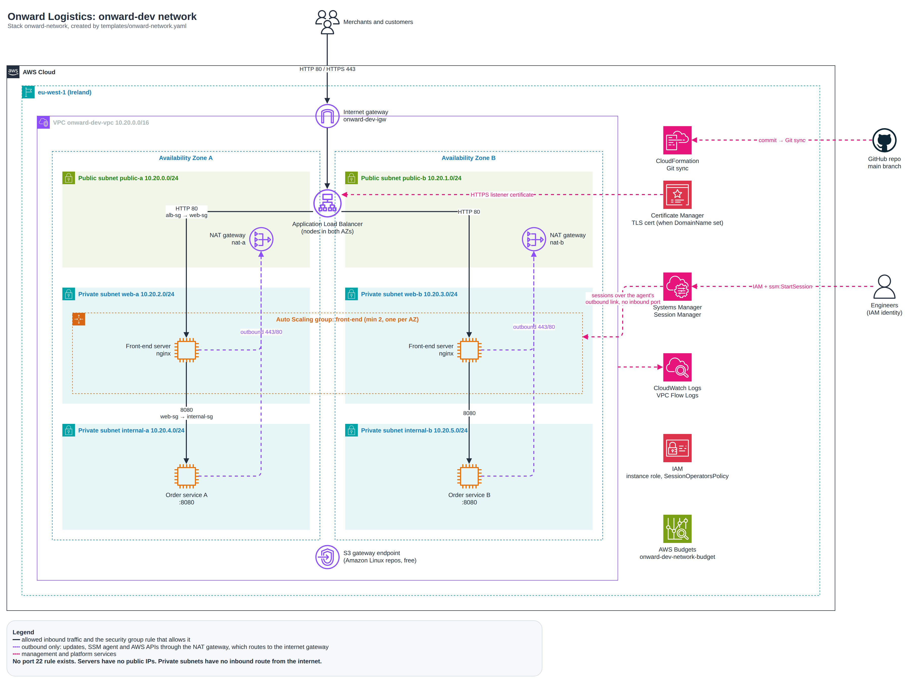

# Architecture: onward-dev network

Every resource in the diagram is created by `templates/onward-network.yaml`.

The source is [architecture.drawio](architecture.drawio). To edit it in VS Code, install the recommended [Draw.io Integration](https://marketplace.visualstudio.com/items?itemName=hediet.vscode-drawio) extension (VS Code offers it when you open the repo, from `.vscode/extensions.json`), then open the file. You can also use [diagrams.net](https://app.diagrams.net). After editing, export it again as `architecture.png` (File > Export as > PNG, zoom 200%).

## Traffic rules

| From | To | Port | Allowed by |
|---|---|---|---|
| Internet | ALB | 80 | `onward-dev-orders-alb-sg` ingress 0.0.0.0/0 |
| Internet | ALB | 443 (only when `DomainName` is set; port 80 then redirects to HTTPS) | `onward-dev-orders-alb-sg` ingress 0.0.0.0/0 |
| ALB | Front-end servers | 80 | ALB egress to `web-sg`, `web-sg` ingress from `alb-sg` |
| Front-end servers | Order services | 8080 | `web-sg` egress to `internal-sg`, `internal-sg` ingress from `web-sg` |
| Any server | Internet (updates, SSM, AWS APIs) | 443, 80 outbound | SG egress + private route 0.0.0.0/0 to NAT |
| Internet | Any server | any | Nothing. Servers have no public IP and private subnets have no inbound route |
| Anyone | Port 22 | 22 | Nothing. No rule exists |

## Why engineers can log in with no open port

The SSM Agent on each server opens an outbound HTTPS connection to Systems Manager through the NAT Gateway. When an engineer runs `aws ssm start-session`, Systems Manager checks the engineer's IAM permissions (the `SessionOperatorsPolicy` output), then relays the shell over that existing outbound connection. Nothing ever connects inward to the server.

## What happens when a component fails

| Failure | Effect on users | Recovery |
|---|---|---|
| One front-end server crashes | None noticeable. ALB marks it unhealthy after 2 failed checks (about 20 s) and sends all traffic to the other | ASG launches a replacement automatically |
| A whole AZ is lost | Site stays up on the other AZ's ALB node and server | ASG launches replacements in the healthy AZ until the AZ returns |
| One NAT Gateway (per-az mode) | Only that AZ loses outbound updates; the website is unaffected | AWS replaces the NAT; the other AZ is untouched |
| The NAT Gateway (single mode) | Servers in both AZs lose outbound updates; the website still serves pages | Switch to per-az mode with a one-line Git commit |
| An order-service server | The other AZ's order service keeps running | Rebuild with a stack update (an internal load balancer is the next step for production) |
| A bad template change | Git sync rolls the stack back to the last good state | Revert the commit |
